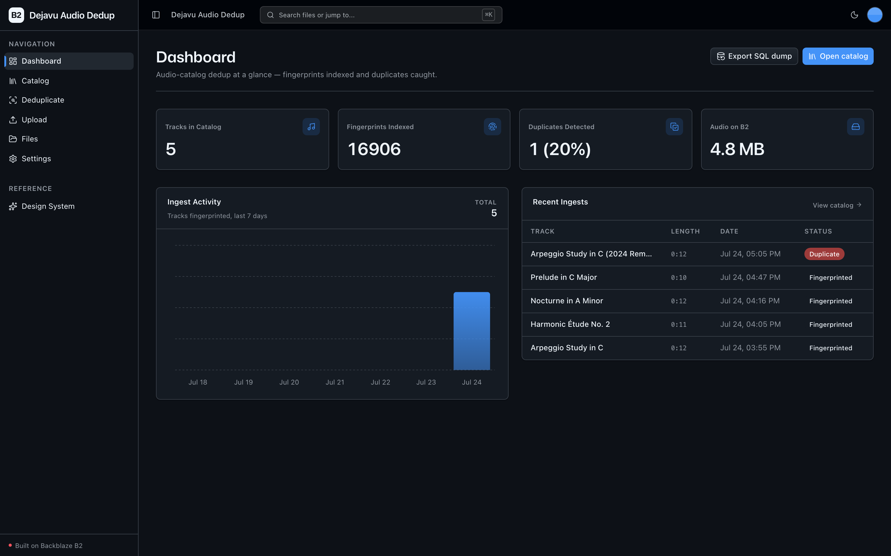
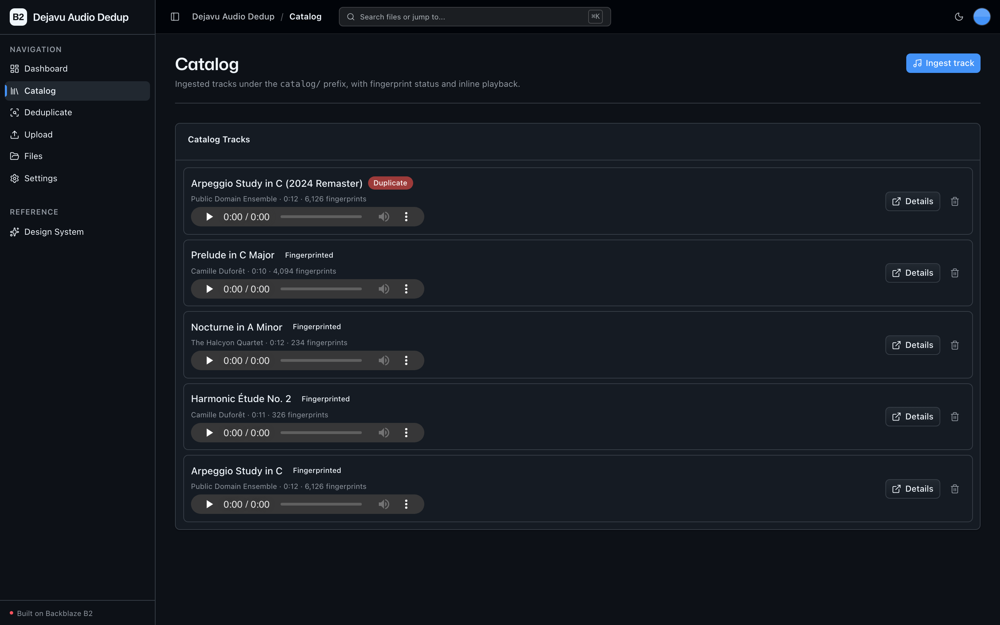
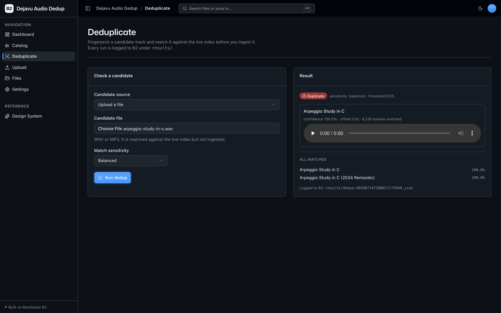
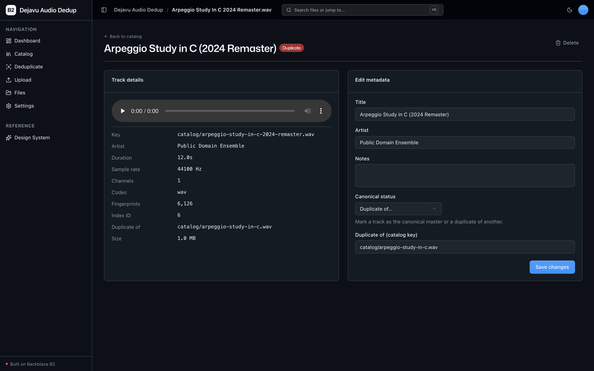

<!-- last_verified: 2026-07-24 -->
# Dejavu Audio Dedup

Deduplicate large audio catalogs before ingest, with **[Backblaze B2](https://www.backblaze.com/sign-up/ai-cloud-storage?utm_source=github&utm_medium=referral&utm_campaign=ai_artifacts&utm_content=b2ai-dejavu-audio-dedup)** as the durable storage layer. Music streaming platforms and podcast networks ingest big raw audio libraries (WAV/MP3) and need to answer one question before adding a track: *have we seen this recording already?*

This sample answers it end to end using **[Dejavu](https://github.com/worldveil/dejavu)**, the open-source acoustic-fingerprinting library, as a fully **local** matching engine (no external API, no second key — B2 credentials only):

- **B2 is the durable source of truth** for the raw audio catalog **and** every derived artifact — the portable SQL fingerprint dump, the per-track JSON manifest, and the dedup result logs. Nothing app-specific lives outside B2 except the live queryable index.
- **Dejavu runs locally**: it decodes each file, computes spectrogram-peak fingerprint hashes, and populates a **MySQL** fingerprint database (its canonical backend). New candidate tracks are fingerprinted and matched against that index; duplicates are flagged and logged to B2.

**What you get out of the box:**
- Full-stack dashboard UI (Next.js 16 + React 19 + Tailwind v4 + shadcn/ui)
- **Catalog** view — ingest WAV/MP3, fingerprint locally, browse tracks with inline playback and fingerprint status
- **Deduplicate** view — match a candidate (upload or existing track) against the live index; every run logged to B2
- FastAPI backend with strict layered architecture and structural tests
- Bucket explorer + generic upload (the reusable B2-backed scaffolding)

## What it looks like

**Dashboard** — dedup metrics (tracks in catalog, fingerprints indexed, duplicates detected), a 7-day ingest-activity chart, and recent ingests.



**Catalog** — the ingested audio library with per-track fingerprint status, inline players, and re-uploads flagged as duplicates.



**Deduplicate** — match a candidate against the live index and get the verdict: matched track, confidence, time offset, and hashes matched, with every run logged to B2.



**Track detail** — a track's fingerprint metadata and its canonical/duplicate relationship, with editable title, artist, and notes.



## How the two index layers relate

MySQL is the **live, queryable** index Dejavu matches against — populated at ingest. **B2 holds the durable copy** (raw audio + the SQL dump + the manifest) from which MySQL can be re-seeded. Dejavu never queries B2 directly: the "match against the B2-stored index" story is *restore dump → MySQL → query*. See [ARCHITECTURE.md](ARCHITECTURE.md).

## Quick Start

You need: Node.js >= 20, pnpm >= 9, Python >= 3.11, Docker (for MySQL), `ffmpeg` (for MP3 decode; WAV needs none), and a free **[Backblaze B2 account](https://www.backblaze.com/sign-up/ai-cloud-storage?utm_source=github&utm_medium=referral&utm_campaign=ai_artifacts&utm_content=b2ai-dejavu-audio-dedup)**.

### 1. Install dependencies

```bash
pnpm install
```

### 2. Set up the backend

```bash
cd services/api
python3 -m venv .venv && source .venv/bin/activate
pip install -r requirements.txt
# Dejavu is pinned but installed WITHOUT its (ancient) deps so it uses the
# modern, compatible numpy/scipy above — see requirements.txt for why.
pip install --no-deps "PyDejavu @ git+https://github.com/worldveil/dejavu@e56a4a221ad204654a191d217f92aebf3f058b62"
cd ../..
```

> `ffmpeg` is required only to decode MP3 (via pydub). On macOS: `brew install ffmpeg`. WAV works without it.

### 3. Start MySQL (Dejavu's fingerprint backend)

```bash
docker compose -f infra/docker-compose.yml up -d mysql
```

This starts a `mysql:8` service whose credentials match the `FP_DB_*` defaults in `.env.example`.

### 4. Add your B2 credentials

```bash
cp .env.example .env
```

Open `.env` and head to the [Backblaze B2 dashboard](https://secure.backblaze.com/b2_buckets.htm?utm_source=github&utm_medium=referral&utm_campaign=ai_artifacts&utm_content=b2ai-dejavu-audio-dedup):

1. **Create a bucket** → paste its **Bucket Unique Name** into `B2_BUCKET_NAME`, and set `B2_REGION` to the region in its S3 endpoint (e.g. an endpoint of `s3.us-west-004.backblazeb2.com` means `B2_REGION=us-west-004`).
2. **Create an application key** with `Read and Write` → paste **keyID** into `B2_APPLICATION_KEY_ID` and **applicationKey** into `B2_APPLICATION_KEY` *(shown once)*.

The S3 endpoint is derived from `B2_REGION` (`https://s3.<B2_REGION>.backblazeb2.com`).

### 5. Run it

```bash
pnpm dev
```

Frontend at `localhost:3000`, API at `localhost:8000`. Open **Catalog**, ingest a WAV/MP3, then re-upload it in **Deduplicate** to see it flagged. Interactive API docs at `localhost:8000/docs`.

## Core Features

- [Audio Ingest & Fingerprinting](docs/features/audio-ingest.md) — upload WAV/MP3 → store to `catalog/` → fingerprint locally → MySQL populated → manifest updated
- [Deduplicate Before Ingest](docs/features/deduplicate.md) — fingerprint a candidate, match against the index, flag and log the verdict
- [Catalog Explorer](docs/features/catalog.md) — app-scoped `catalog/` view with fingerprint status and inline playback
- [Fingerprint Index Export](docs/features/fingerprint-index.md) — dump the MySQL DB (`index/fingerprints.sql`) + per-track manifest back to B2
- [File Browser](docs/features/file-browser.md) — full-bucket browse over every object (audio + artifacts)
- [File Upload](docs/features/file-upload.md) — generic drag-and-drop B2 upload
- [Dashboard](docs/features/dashboard.md) — dedup metrics, ingest-activity chart, recent ingests

## Tech Stack

- TypeScript, Next.js 16, React 19, Tailwind v4, shadcn/ui, Recharts, TanStack Query
- Python 3.11+, FastAPI, boto3, Pydantic v2, Dejavu (acoustic fingerprinting), MySQL, mutagen
- Backblaze B2 (S3-compatible object storage) — durable store for audio + fingerprint artifacts
- pnpm workspaces (monorepo)

## Commands

| Command | What it does |
|---------|-------------|
| `pnpm dev` | Start frontend + backend |
| `pnpm dev:web` | Frontend only |
| `pnpm dev:api` | Backend only |
| `pnpm build` | Build frontend |
| `pnpm lint` | Lint frontend |
| `pnpm lint:api` | Lint backend (ruff) |
| `pnpm test:web` | Frontend unit tests (vitest) |
| `pnpm test:api` | Backend tests (pytest) |
| `pnpm check:structure` | Verify layering + SDK-containment rules |
| `pnpm test:e2e` | Playwright e2e (run `pnpm --filter @dejavu-audio-dedup/web exec playwright install chromium` once first) |

## Documentation Map

| Doc | Purpose |
|-----|---------|
| [AGENTS.md](AGENTS.md) | Agent table of contents — start here |
| [ARCHITECTURE.md](ARCHITECTURE.md) | System layout, layering, data flows, the two-index model |
| [docs/features/](docs/features/) | Feature docs (ingest, dedup, catalog, index export, browser, upload, dashboard) |
| [docs/app-workflows.md](docs/app-workflows.md) | User journeys |
| [docs/dev-workflows.md](docs/dev-workflows.md) | Engineering workflows and testing |
| [docs/SECURITY.md](docs/SECURITY.md) | Security principles |
| [docs/RELIABILITY.md](docs/RELIABILITY.md) | Reliability expectations |
| [docs/exec-plans/](docs/exec-plans/) | Execution plans and tech debt tracker |

## License

MIT License - see [LICENSE](LICENSE) for details.

## Claude Agent B2 Skill

Manage Backblaze B2 from your terminal using natural language (list/search, audits, stale or large file detection, security checks, safe cleanup).

Repo: [https://github.com/backblaze-b2-samples/claude-skill-b2-cloud-storage](https://github.com/backblaze-b2-samples/claude-skill-b2-cloud-storage)
